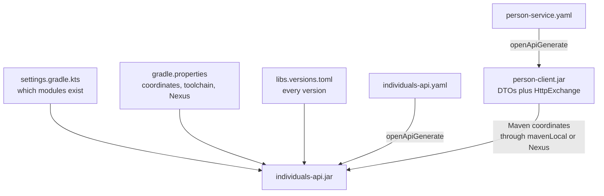
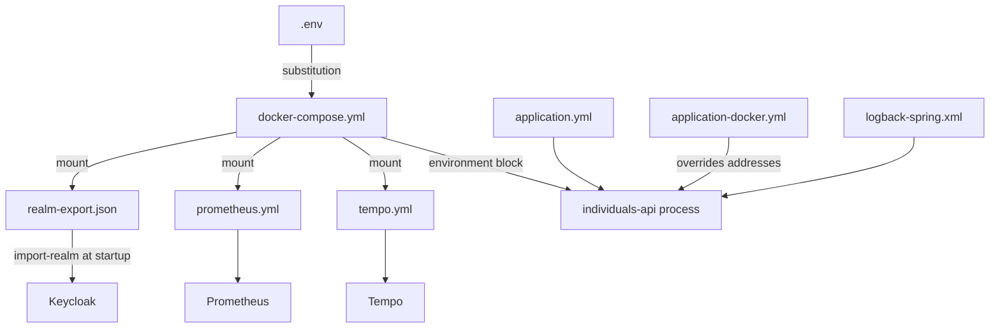
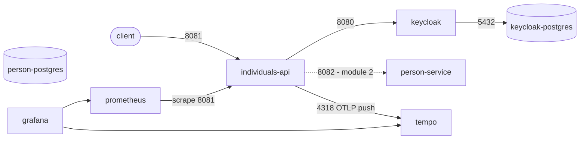

# CONTEXT

Project context for humans and LLMs. Read this first before touching anything.

---

## Module contexts

Each module keeps what was decided and done in it in its own context:

| Module | Context |
|---|---|
| 1 - individuals-api | [`individuals-api/CONTEXT.md`](individuals-api/CONTEXT.md) |
| 2 - person-service | [`person-service/CONTEXT.md`](person-service/CONTEXT.md) |
| 3 - transaction-service | [`transaction-service/CONTEXT.md`](transaction-service/CONTEXT.md) |

This file holds only what all of them share: rules, ports, how the platform
is built, started and checked.

---

## 1. What this repository is

`payment-platform` — monorepo of the payment platform.

Module 1 delivers **individuals-api**: the external entry layer that
orchestrates user registration and authentication. It stores nothing itself.

| Component | Is the source of truth for |
|---|---|
| `person-service` | individuals: each holds its user (account) and the user's address |
| Keycloak | the account, tokens, roles, auth attributes |
| `individuals-api` | nothing — it only coordinates the two above |

**Where a value is stored is not who owns the truth about it.** The same first
name sits in person-service and in the Keycloak account, but only one of them
is the source: the account holds a copy, written once at registration, and
nobody keeps it in step afterwards. Reading a domain field out of Keycloak
because it happens to be there is the easiest way to lose this boundary — see
`/me` in section 3 of `individuals-api/CONTEXT.md` for where module 1 does exactly that, and why.

The root is deliberately named after the platform, not after one service:
`transaction-service`, `payment-service`, `webhook-collector-service` and
`notification-service` land here in later modules.

### The whole platform, for later modules

Recorded from the course description of the full system, so that later modules
do not drift from it. Only the first two rows exist today.

| Service | Type | Owns | Talks to |
|---|---|---|---|
| **Individuals API** | orchestrator | nothing, no database | Keycloak (Admin + Token API), every domain service |
| **Keycloak** | external IAM | credentials, roles, JWT issuing and validation | - |
| **Users Service** | domain | the business profile: name, country, address | called only through Individuals API |
| **Wallets Service** | domain | wallets and balances, internal transfers | Kafka consumer |
| **Payments Service** | domain | deposit, transfer and withdrawal transactions | Currency Service, Fake Payment Provider, Kafka |
| **Currency Service** | utility | exchange rates from an external provider | called by Payments Service |
| **Webhook Service** | integration | inbound webhooks from the provider | publishes to Kafka, processes nothing itself |
| **Notification Service** | infrastructure | user notifications, plus a REST API to read them | Kafka consumer |
| **Fake Payment Provider** | external stub | imitates a real payment gateway, answers by webhook | - |

Behaviour the description fixes, and that later modules must not invent
differently:

- **Balances change only on Kafka events** (`transaction.completed`,
  `transaction.failed`). Wallets Service never adjusts a balance from a REST
  call.
- **`/init` writes nothing to the database.** A payment transaction is
  persisted only once `/confirm` succeeds.
- **The webhook endpoint is protected by a shared secret**, checked on every
  call.
- **Webhook Service only publishes** `payment.status.updated`; the consumers
  decide what it means.
- Notification Service reacts to events such as `user.registered` and
  `transaction.completed`.

Two integration styles coexist on purpose: synchronous REST where an answer is
needed now, Kafka where the work can finish later. Compensation exists because
of the first style - see "Compensation policy" in `individuals-api/CONTEXT.md`.

---

## 2. Fixed technical decisions

These are settled. Do not change them without an explicit decision.

| Decision | Value | Where it lives |
|---|---|---|
| Build layout | one independent Gradle build per module, no root project | each module's `settings.gradle.kts` |
| Base package | `com.dezxxx.individuals` | — |
| Maven group | `com.dezxxx` | each module's `gradle.properties` |
| Java | 25 (Gradle toolchain, ignores `JAVA_HOME`) | each module's `gradle.properties` |
| Spring Boot | 4.1.0 | `gradle/libs.versions.toml`; person-service: its `build.gradle.kts` |
| Gradle | 9.5.1 via Wrapper | `gradle/wrapper/` |
| Lombok | yes — 1.18.46 | individuals-api: `gradle/libs.versions.toml`; person-service: the Spring Boot BOM |
| OpenAPI Generator | 7.25.0 in both modules, with `useSpringBoot4` and JSpecify `@Nullable` (`useJspecify`) | person-service: its `build.gradle.kts`; individuals-api: `gradle/libs.versions.toml` |
| Build tool | Gradle Kotlin DSL only | — |
| Keycloak image | 26.7.2 | `.env` |
| Testcontainers | 2.0.5, inherited from the Boot BOM | artifact ids differ from 1.x — see section 5 of `individuals-api/CONTEXT.md` |

The Gradle toolchain provisions JDK 25 itself, so whatever `JAVA_HOME` points
at is irrelevant to the build and must not be "fixed" to make it work.

### Version policy

**One version of each tool across all modules.** Nobody should have to work out
which module runs which Gradle, Boot or generator.

| File | Holds |
|---|---|
| person-service `build.gradle.kts` | its three plugin versions; library versions come from the Spring Boot BOM, so no dependency line carries one |
| `gradle/libs.versions.toml` | the same for individuals-api, until it follows person-service - then the file goes |
| `gradle.properties` | coordinates, toolchain, Nexus URLs |
| `.env` | image tags, ports and credentials for docker-compose |

---

## 3. Architectural rules

0. **Reactive stack — Spring WebFlux, not Spring MVC.** Required by the
   handout. Netty instead of Tomcat, `Mono`/`Flux` instead of plain return
   types, `WebClient` instead of `RestClient`, `SecurityWebFilterChain` instead
   of `SecurityFilterChain`. Nothing in the service may block the event loop:
   no `.block()`, no blocking JDBC, no blocking HTTP client. Both OpenAPI
   modules are generated with `reactive = true`, so the contracts themselves
   are `Mono`-typed and a blocking implementation would not even compile
   against them.

1. **Contract first, always.** The OpenAPI spec is written before the code.
   Nothing is hand-written that a generator can produce.
   - `individuals-api/openapi/individuals-api.yaml` — server interfaces are
     generated from it; controllers *implement* them, so the code cannot drift
     from the contract.
   - `person-service/openapi/person-service.yaml` — `person-client` generates
     DTOs and `@HttpExchange` clients from it.

2. **No hand-written DTOs.** Every DTO comes out of a generator.

3. **No `project(":...")` dependencies between modules.** Cross-module
   contracts travel as artifacts published to Nexus, addressed by Maven
   coordinates. Modules are `include`d only so one wrapper builds them all.

4. **Transport = Spring HTTP Service Clients + WebClient.** No Feign, and no
   `RestClient` either. `person-client` is generated with
   `library = spring-http-interface`, and the proxies are built with
   `WebClientAdapter` so every call returns a `Mono`. The handout names
   `RestClient`; see the deviations table for why the adapter differs while the
   style does not.

   Module 2's handout says the same in stronger words - use HTTP Service
   Clients, **not** Spring Cloud OpenFeign, which it calls feature-complete.
   The `Feign/OpenAPI` label on the platform diagram predates both and is not a
   requirement.

   person-service needs no HTTP client at all: it answers calls and owns a
   database, it does not make outbound calls. `person-client` is for its
   callers, starting with individuals-api.

5. **Every build validates the contracts** — `openApiValidate` runs before
   `openApiGenerate`, and `check` depends on it. A broken contract fails the
   build, not the runtime.

6. **Request rules are declared in the contract, not written by hand.** The
   build sets `useBeanValidation = true`, so `@NotNull`, `@Size`, `@Email` and
   the rest are generated straight out of the schema keywords and nobody
   maintains them. OpenAPI has no keyword for "this field equals that one", and
   the confirmation rule is the only place where that matters: it is written as
   a class-level constraint in `validation` and attached to the generated model
   through `x-class-extra-annotation` on the schema. The rule therefore still
   lives in the contract — only its body is in Java — and it is applied by the
   same `@Valid` as everything else, with no call a controller must remember to
   make. Nothing above validates a request a second time.

   **The language of a validation message is left to the machine.** The
   generated constraints answer from Hibernate Validator's own bundles, chosen
   by the JVM default locale, so this service replies in Russian on a Russian
   Windows and in English inside a container — and `must match password`, being
   ours and hard-coded, stays English either way, so one `details` array can
   carry both. Deliberate for module 1: there is one deployment, a local
   machine, and its owner sets its rules. Pinning the language later is a bean
   — a message interpolator fixed to one locale, or one reading the request's
   `Accept-Language` if real localisation is ever wanted — and no other code
   moves.

### Observability

**Metrics.** Actuator plus Prometheus. Only `health` is exposed over HTTP by
default, so the Prometheus endpoint is turned on explicitly:

```yaml
management:
  endpoints:
    web:
      exposure:
        include: "health,info,prometheus"
  endpoint:
    health:
      probes:
        enabled: true
```

`prometheus.yml` must point at `metrics_path: /actuator/prometheus`.

Required application meters:

| Meter | Type | Meaning |
|---|---|---|
| `auth.registration` | counter | registration attempts |
| `auth.registration.success` | counter | successful registrations |
| `auth.registration.failure` | counter | failed registrations |
| `auth.login` | counter | logins |
| `auth.login.failure` | counter | failed logins |
| `auth.refresh` | counter | token refreshes |
| `external.keycloak.requests` | timer | Keycloak call duration |
| `external.person_service.requests` | timer | person-service call duration |

Named in Micrometer's dotted convention, **not** with the `_total` suffix the
handout table shows. Prometheus appends `_total` to counters itself, so a meter
registered as `auth_registration_total` is scraped as
`auth_registration_total_total`. The handout lists the scraped names; the code
must register the dotted ones.

**Histogram buckets are switched on for `http.server.requests`.** Boot
publishes `count`, `sum` and `max` for its built-in HTTP timer and nothing
else, which is enough for an average and useless for a percentile -
`histogram_quantile` has no buckets to read. The dashboard's 95th percentile
panel had been drawing from data nobody had enabled, and showed an empty graph
without an error anywhere.

An average would have been the wrong fix: nine fast requests and one slow one
average out to "fine", and the slow one is the whole reason the panel exists.
Enabled for that one meter rather than globally - each bucket is its own line
in the scrape, and the built-in HTTP timer is the only place a percentile is
worth that.

**Tracing.** Micrometer Tracing over OpenTelemetry, exported by OTLP:

```yaml
management:
  tracing:
    sampling:
      probability: 1.0
  opentelemetry:
    tracing:
      export:
        otlp:
          endpoint: http://tempo:4318/v1/traces
```

The `management.opentelemetry.tracing.export.otlp.*` namespace is the Boot 4
one - Boot 3 used `management.otlp.tracing.*`. Trace context propagates across
the network only when the HTTP client is built from Spring's autoconfigured
builders, which is another reason the gateways must not construct their own.

**Logs.** JSON to stdout, every record carrying: service name, `traceId`,
`spanId`, request path, HTTP method, response status, business error code, and
the domain `user_uid` when known.

---

## 4. Port map

Host ports, as fixed by the course handout. Values live in `.env`, never in
`docker-compose.yml`.

| Service | Host | Container |
|---|---|---|
| keycloak | 8080 | 8080 |
| individuals-api | 8081 | 8081 |
| keycloak-postgres | 5433 | 5432 |
| person-postgres | 5434 | 5432 |
| prometheus | 9090 | 9090 |
| tempo | 3200, 4318 | 3200, 4318 |
| loki | 3100 | 3100 |
| alloy | - | - |
| grafana | 3000 | 3000 |

`person-service` gets 8082 in module 2 - not from the handout, chosen because
8081 is taken. The OpenAPI `servers` entries follow this table.
`transaction-service` gets 8084 in module 3: the handout's 8082 belongs to
person-service and 8083 to Nexus.

**Nexus runs on 8083, not on its own default 8081.** The handout fixes 8081 for
individuals-api, so Nexus is the one that has to move; the URLs live in
`gradle.properties`. Until Nexus is up, that unreachable repository is also why
IntelliJ reports `Sources were not downloaded for ...`: an ordinary build finds
the jar in Maven Central and never reaches the third repository, but the IDE
asks every repository for sources and reports the whole lookup as failed.

---

## 5. Module layout

```
payment-platform/              a Git root, NOT a Gradle project
├── gradle/libs.versions.toml  every version - a plain file each module reads
├── docker-compose.yml
├── .env                       image tags, ports, credentials (not in git)
├── infra/                     prometheus, tempo, loki, alloy, grafana provisioning
├── postman/                   one collection per service: every endpoint and its failures
├── individuals-api/           the orchestrator; its C4 diagrams in diagrams-c4/
├── person-service/            the individual aggregate; also publishes person-service-client -> Nexus
│                              its C4 diagrams in diagrams-c4/
└── transaction-service/       wallets and transactions (module 3); its C4 diagrams in diagrams-c4/
```

Each module is an independent Gradle build: its own `settings.gradle.kts`,
`gradle.properties`, wrapper and conventions. The handout requires it - "the
root is not a Maven/Gradle project, it is a package that plays the role of a
Git root", and every cross-module dependency travels as a published artifact.

individuals-api still reads `gradle/libs.versions.toml` as
`from(files("../gradle/libs.versions.toml"))`. person-service reads nothing from
outside its folder: plugin versions are in its own `build.gradle.kts`.

---

## 6. Build order

`make` does all of it: `make` alone starts Nexus, builds the image and starts
the stack, and `make help` lists the rest. The `Makefile` exists because there
is no root build to hang the order on. `make verify` runs the whole order from
scratch (person-service `clean check`, client into Nexus, individuals-api
`clean build`, images `--no-cache`, stack up); `make verify-down` stops the
stack first, because the integration tests need its memory.

What it runs, for when it is not installed:

`person-service-client` must exist as an artifact before `individuals-api`
resolves. person-service builds and publishes it; there is no root build to do
both, so each module is built from its own folder. Until Nexus is up,
`mavenLocal()` covers the hand-over:

```bash
cd person-service  && ./gradlew publishClientPublicationToMavenLocal
cd person-service  && ./gradlew check      # contract, unit + integration tests, 80% coverage gate
cd individuals-api && ./gradlew build
```

Into Nexus: `make publish` (`publishClientPublicationToNexusRepository`;
`NEXUS_USERNAME` / `NEXUS_PASSWORD` default to `NEXUS_ADMIN_USER` /
`NEXUS_ADMIN_PASSWORD` from `.env`).

**The image builds individuals-api itself**, as in the teacher's reference: a
JDK stage runs `bootJar`, a JRE stage runs the jar. The build context is the
repository root, because the module reads `gradle/libs.versions.toml` from
there. `person-service-client` is downloaded from Nexus through
`host.docker.internal:8083` - a docker build runs outside the compose network,
so it reaches Nexus through the host's port. That is why Nexus must be up and
hold the artifact first:

```bash
docker compose up -d --wait nexus     # healthcheck on /service/rest/v1/status
docker compose up -d --build
```

Nexus allows anonymous reads, so no password enters the image. Tests do not
run in the image - `make test` and `make it` do that.

---

## 7. Running and checking

- `make` starts Nexus, builds the images and brings up the stack; `make help`
  lists the rest (build order: section 6).
- `make verify` checks everything from scratch; `make verify-down` stops the
  stack first, because the integration tests need its memory.
- Every service answers `/actuator/health` on its port (section 4).
- `postman/` holds one collection per service; run it on a fresh stack
  (`make reset-db`).

---

## 8. Configuration map

Each service keeps its C4 diagrams in its own `diagrams-c4/`: container, component
and sequence, PlantUML in `uml/{en,ru}` and a rendered PNG in `png/{en,ru}`. The
Mermaid below is the copy that renders on GitHub without a plugin.

The files here work at two different times and mostly do not know about each
other. What binds them is a handful of values that must agree - and those are
exactly the places that break silently.

### Build time - no containers exist yet



The OpenAPI specs live only here. At runtime nothing reads them - the code was
already generated from them.

### Run time - who reads what



`.env` is substituted into the compose file itself. It does **not** reach the
container - only the `environment:` block does. That is why individuals-api
lists `KEYCLOAK_REALM`, `KEYCLOAK_CLIENT_ID` and `KEYCLOAK_CLIENT_SECRET`
explicitly.

### Run time - who talks to whom



Two opposite mechanics, and they are easy to confuse. **Prometheus pulls** -
it walks to the application on a schedule, so the application's address lives
in `prometheus.yml`. **The application pushes** traces, so Tempo's address
lives in `application.yml`. One arrow points each way.

### Values that must agree

Every row is a place where a mismatch breaks something without raising an
error anywhere.

| Coupling | One side | Other side | What must match |
|---|---|---|---|
| metrics scrape | `prometheus.yml` target `individuals-api:8081` | compose service name plus `server.port` | name and port |
| metrics path | `prometheus.yml` `metrics_path` | `application.yml` `exposure.include` | prometheus is exposed |
| traces | `application-docker.yml` `tempo:4318/v1/traces` | `tempo.yml` OTLP http receiver | host, port, path |
| Tempo storage | `tempo.yml` `/var/tempo/...` | compose `tempo-data:/var/tempo` | the path |
| realm name | `.env` `KEYCLOAK_REALM` | `realm-export.json` `realm` | the value |
| client id | `.env` `KEYCLOAK_CLIENT_ID` | `realm-export.json` `clientId` | the value |
| client secret | `.env` `KEYCLOAK_CLIENT_SECRET` | `realm-export.json` `secret` | the value |
| app port | `application.yml` `server.port` | compose `8081:8081` | the right-hand side |

How this bites: change `server.port` to 8080 and forget `prometheus.yml`. The
application starts, `/actuator/prometheus` answers, and Prometheus quietly
scrapes a refused connection. No error in the application log - just an empty
graph in Grafana.

---

## 9. Build notes

### Known noise, not defects

- ~100 deprecation warnings from generated sources: OpenAPI Generator 7.14.0
  emits `org.springframework.lang.@Nullable`, deprecated in Spring 7. Harmless;
  worth silencing on the generated source set rather than in the generator.
- `Ignoring complex example on request body` — the generator does not carry
  multi-example blocks into code. The examples stay in the contract, which is
  where the handout wants them.

### Why Gradle 9.5.1 and not the latest

The wrapper was originally pinned to 9.7.1, which is the current Gradle
release. The build works on it. IntelliJ IDEA 2025.2.6 does not: its Kotlin
plugin loads the script *templates* from the Gradle distribution but never
produces the per-script model, so every `build.gradle.kts` shows as fully
unresolved in the editor — down to `mapOf` and `to` from the Kotlin standard
library — while `./gradlew build` stays green.

The build files are not at fault and were not changed: dropping the wrapper to
9.5.1 and re-syncing cleared the editor on its own.

Revisit when IDEA ships support for Gradle 9.7. Moving back is one line in
`gradle/wrapper/gradle-wrapper.properties` — nothing in the build depends on
the version.

---

## 10. Working agreements

- No commit or push without explicit approval, every time.
- Commit author is always `Sergey Zatulsky <web7tudio@gmail.com>`.
- Commit messages in English, `type: short description`.
- Communication in Russian, code and comments in English.
- `CONTEXT.md` and `CONTEXT.ru.md` are edited together; English is the source
  of truth if the two ever disagree.
