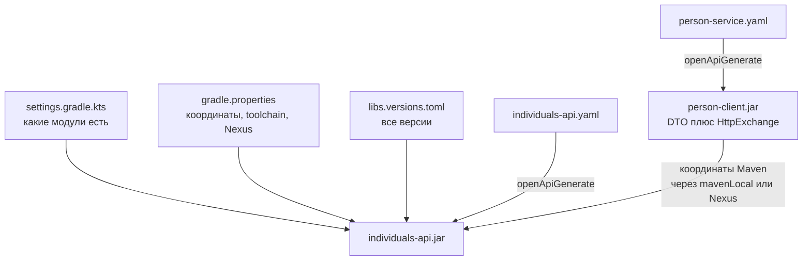
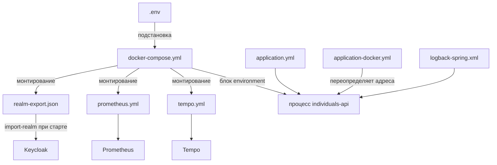
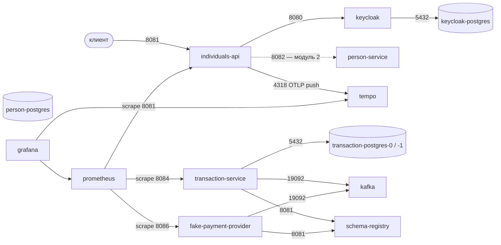

# CONTEXT (русская версия)

Контекст проекта для людей и для LLM. Прочитать до того, как что-то трогать.

> Это перевод `CONTEXT.md`. Английская версия — основная: когда что-то меняется,
> правятся **оба** файла. Если тексты разошлись — прав английский.

---

## Как читать этот проект

1. Этот файл: правила, обязательные для каждого модуля, и как платформа
   собирается, запускается и проверяется.
2. Контекст модуля, с которым работаешь: как он устроен, что решено, что
   дальше.

| Модуль | Контекст |
|---|---|
| 1 - individuals-api | [`individuals-api/CONTEXT.ru.md`](individuals-api/CONTEXT.ru.md) |
| 2 - person-service | [`person-service/CONTEXT.ru.md`](person-service/CONTEXT.ru.md) |
| 3 - transaction-service | [`transaction-service/CONTEXT.ru.md`](transaction-service/CONTEXT.ru.md) |
| 3 - fake-payment-provider | [`fake-payment-provider/CONTEXT.ru.md`](fake-payment-provider/CONTEXT.ru.md) |

---

## 1. Что это за репозиторий

`payment-platform` — монорепозиторий платёжной платформы.

| Компонент | Источник правды для |
|---|---|
| `person-service` | физлиц: у каждого его user (учётка) и адрес user |
| Keycloak | учётной записи, токенов, ролей, атрибутов аутентификации |
| `individuals-api` | ничего — только координирует двух выше |

**Где значение лежит — не значит, кому принадлежит правда о нём.** Одно и то же
имя есть и в person-service, и в учётной записи Keycloak, но источник только
один: в учётке лежит копия, записанная один раз при регистрации, и дальше её
никто не синхронизирует. Прочитать доменное поле из Keycloak просто потому, что
оно там оказалось, — самый лёгкий способ потерять эту границу. Где именно
модуль 1 так и делает и почему — см. `/me` в разделе 3 `individuals-api/CONTEXT.ru.md`.

Корень назван по платформе, а не по одному сервису, намеренно:
`transaction-service`, `payment-service`, `webhook-collector-service` и
`notification-service` приедут сюда в следующих модулях.

### Вся платформа, для будущих модулей

Записано с описания полной системы из курса, чтобы следующие модули от неё не
разъехались. Сегодня существуют только первые две строки.

| Сервис | Тип | Владеет | С кем говорит |
|---|---|---|---|
| **Individuals API** | оркестратор | ничем, базы нет | Keycloak (Admin + Token API), все доменные сервисы |
| **Keycloak** | внешний IAM | учётными данными, ролями, выдачей и проверкой JWT | — |
| **Users Service** | доменный | бизнес-профилем: имя, страна, адрес | вызывается только через Individuals API |
| **Wallets Service** | доменный | кошельками и балансами, внутренними переводами | потребитель Kafka |
| **Payments Service** | доменный | транзакциями пополнения, перевода, вывода | Currency Service, Fake Payment Provider, Kafka |
| **Currency Service** | утилитарный | курсами валют от внешнего провайдера | вызывается Payments Service |
| **Webhook Service** | интеграционный | входящими вебхуками от провайдера | публикует в Kafka, сам ничего не обрабатывает |
| **Notification Service** | инфраструктурный | уведомлениями пользователя + REST для их чтения | потребитель Kafka |
| **Fake Payment Provider** | внешняя заглушка | имитирует платёжный шлюз, отвечает вебхуком | — |

Поведение, которое описание фиксирует, и которое следующие модули не имеют
права придумать иначе:

- **Балансы меняются только по событиям Kafka** (`transaction.completed`,
  `transaction.failed`). Wallets Service никогда не правит баланс по REST-вызову.
- **`/init` ничего не пишет в базу.** Платёжная транзакция сохраняется только
  после успешного `/confirm`.
- **Эндпоинт вебхука защищён общим секретом**, проверяется на каждом вызове.
- **Webhook Service только публикует** `payment.status.updated`; что это значит,
  решают потребители.
- Notification Service реагирует на события вида `user.registered` и
  `transaction.completed`.

Два стиля интеграции сосуществуют намеренно: синхронный REST там, где ответ
нужен сейчас, Kafka там, где работа может завершиться позже. Компенсация
существует из-за первого стиля — см. «Политика компенсации» в `individuals-api/CONTEXT.ru.md`.

---

## 2. Зафиксированные технические решения

Это решено. Не менять без явного решения.

| Решение | Значение | Где живёт |
|---|---|---|
| Схема сборки | по независимой сборке Gradle на модуль, корневого проекта нет | `settings.gradle.kts` каждого модуля |
| Базовый пакет | `com.dezxxx.<модуль>`: `individuals`, `person`, `transaction` | `src/main/java` каждого модуля |
| Maven group | `com.dezxxx` | `gradle.properties` каждого модуля |
| Java | 25 (Gradle toolchain, игнорирует `JAVA_HOME`) | `gradle.properties` каждого модуля |
| Spring Boot | 4.1.0 | `gradle/libs.versions.toml`; person-service — свой `build.gradle.kts` |
| Gradle | 9.5.1 через Wrapper | `gradle/wrapper/` |
| Lombok | да — 1.18.46 | individuals-api — `gradle/libs.versions.toml`; person-service — BOM Spring Boot |
| OpenAPI Generator | 7.25.0 в обоих модулях, с `useSpringBoot4` и `@Nullable` из JSpecify (`useJspecify`) | person-service — свой `build.gradle.kts`; individuals-api — `gradle/libs.versions.toml` |
| Инструмент сборки | только Gradle Kotlin DSL | — |
| Образ Keycloak | 26.7.2 | `.env` |
| Testcontainers | 2.0.5, из Boot BOM | id артефактов отличаются от 1.x — см. раздел 5 `individuals-api/CONTEXT.ru.md` |

Gradle toolchain сам подтягивает JDK 25, поэтому на что указывает `JAVA_HOME`
для сборки неважно — и «чинить» его, чтобы заработало, не надо.

### Политика версий

**У каждого инструмента одна версия во всех модулях.** Никто не должен
выяснять, на каком Gradle, Boot или генераторе работает какой модуль.

| Файл | Держит |
|---|---|
| `build.gradle.kts` person-service | версии трёх его плагинов; версии библиотек приходят из BOM Spring Boot, поэтому ни в одной строке зависимостей версии нет |
| `gradle/libs.versions.toml` | то же для individuals-api, пока он не перейдёт на схему person-service — потом файл уйдёт |
| `gradle.properties` | координаты, toolchain, URL Nexus |
| `.env` | теги образов, порты и учётные данные для docker-compose |

---

## 3. Архитектурные правила

0. **Веб-стек выбирается для каждого модуля.** individuals-api реактивный
   (Spring WebFlux), см. его CONTEXT; person-service и transaction-service —
   Spring MVC.

1. **Сначала контракт, всегда.** Спецификация OpenAPI пишется до кода. Руками
   не пишется ничего, что может выдать генератор.
   - `individuals-api/openapi/individuals-api.yaml` — из него генерируются
     серверные интерфейсы; контроллеры их *реализуют*, поэтому код не может
     разъехаться с контрактом.
   - `person-service/openapi/person-service.yaml` — из него `person-client`
     генерирует DTO и `@HttpExchange`-клиенты.

2. **Никаких рукописных DTO.** Каждый DTO выходит из генератора.

3. **Никаких зависимостей `project(":...")` между модулями.** Межмодульные
   контракты ездят артефактами, опубликованными в Nexus, по Maven-координатам.
   Модули `include`-ятся только чтобы один wrapper собирал их все.

4. **Транспорт = Spring HTTP Service Clients + WebClient.** Ни Feign, ни
   `RestClient`. `person-client` генерируется с
   `library = spring-http-interface`, прокси строятся через `WebClientAdapter`,
   так что каждый вызов возвращает `Mono`. Задание называет `RestClient`;
   почему адаптер отличается, а стиль — нет, см. таблицу отклонений.

   Задание модуля 2 говорит то же самое жёстче: использовать HTTP Service
   Clients, а **не** Spring Cloud OpenFeign, который там назван функционально
   завершённым. Подпись `Feign/OpenAPI` на диаграмме платформы старше обоих
   документов и требованием не является.

   person-service HTTP-клиент не нужен вовсе: он отвечает на вызовы и владеет
   базой, наружу сам не ходит. `person-client` — для тех, кто его вызывает,
   начиная с individuals-api.

5. **Каждая сборка валидирует контракты** — `openApiValidate` идёт перед
   `openApiGenerate`, и `check` от него зависит. Сломанный контракт валит
   сборку, а не рантайм.

6. **Правила запроса объявляются в контракте, а не пишутся руками.** В сборке
   стоит `useBeanValidation = true`, поэтому `@NotNull`, `@Size`, `@Email` и
   остальное генерируются прямо из ключевых слов схемы, и их никто не
   поддерживает. В OpenAPI нет способа сказать «это поле равно тому», и это
   важно ровно в одном месте: правило подтверждения пароля написано как
   ограничение уровня класса в `validation` и прицеплено к сгенерированной
   модели через `x-class-extra-annotation` в схеме. Правило по-прежнему живёт в
   контракте — в Java только его тело — и применяется тем же `@Valid`, что и
   всё остальное, без вызова, который контроллер обязан не забыть сделать.
   Выше запрос повторно никто не валидирует.

   **Язык сообщения валидации отдан машине.** Сгенерированные ограничения
   отвечают из словарей самого Hibernate Validator, а словарь выбирается по
   локали JVM — поэтому на русской Windows сервис отвечает по-русски, а внутри
   контейнера по-английски; наше собственное `must match password` захардкожено
   и остаётся английским в любом случае, так что один массив `details` может
   нести оба языка. Для модуля 1 это осознанно: развёртывание одно, локальная
   машина, и правила на ней устанавливает её владелец. Зафиксировать язык позже
   — это бин: интерполятор сообщений с прибитой локалью либо читающий
   `Accept-Language` запроса, если понадобится настоящая локализация. Остальной
   код при этом не двигается.

### Наблюдаемость

**Метрики.** Actuator плюс Prometheus. По умолчанию наружу отдаётся только
`health`, поэтому эндпоинт Prometheus включается явно:

```yaml
management:
  endpoints:
    web:
      exposure:
        include: "health,info,prometheus"
  endpoint:
    health:
      probes:
        enabled: true
```

`prometheus.yml` обязан указывать на `metrics_path: /actuator/prometheus`.

Свои метрики приложения каждый модуль перечисляет в своём CONTEXT.

Названы в точечной конвенции Micrometer, **без** суффикса `_total`, который
показан в таблице задания. Prometheus сам дописывает `_total` счётчикам, поэтому
метрика, зарегистрированная как `auth_registration_total`, соберётся как
`auth_registration_total_total`. Задание перечисляет имена **после** сбора; код
обязан регистрировать точечные.

**Для `http.server.requests` включены бакеты гистограммы.** Boot публикует для
своего встроенного HTTP-таймера только `count`, `sum` и `max` — этого хватает на
среднее и бесполезно для перцентиля: `histogram_quantile` нечего читать. Панель
95-го перцентиля на дашборде рисовала из данных, которых никто не включал, и
показывала пустой график без единой ошибки.

Среднее было бы неверным решением: девять быстрых запросов и один медленный
дают в среднем «нормально», а медленный — это и есть то, ради чего панель
существует. Включено только для этой метрики, не глобально: каждый бакет — своя
строка в скрейпе, и встроенный HTTP-таймер единственное место, где перцентиль
этого стоит.

**Трассировка.** Micrometer Tracing поверх OpenTelemetry, экспорт по OTLP:

```yaml
management:
  tracing:
    sampling:
      probability: 1.0
  opentelemetry:
    tracing:
      export:
        otlp:
          endpoint: http://tempo:4318/v1/traces
```

Пространство имён `management.opentelemetry.tracing.export.otlp.*` — это Boot 4;
в Boot 3 было `management.otlp.tracing.*`. Контекст трейса передаётся по сети
только тогда, когда HTTP-клиент собран из автоконфигурированных билдеров Spring
— ещё одна причина, почему шлюзы не имеют права строить свой собственный.

**Логи.** JSON в stdout, каждая запись несёт: имя сервиса, `traceId`, `spanId`,
путь запроса, HTTP-метод, статус ответа, бизнес-код ошибки и доменный `user_uid`,
когда он известен.

---

## 4. Карта портов

Порты хоста, зафиксированы заданием курса. Значения живут в `.env`, никогда в
`docker-compose.yml`.

| Сервис | Хост | Контейнер |
|---|---|---|
| keycloak | 8080 | 8080 |
| individuals-api | 8081 | 8081 |
| keycloak-postgres | 5433 | 5432 |
| person-postgres | 5434 | 5432 |
| person-service | 8082 | 8082 |
| transaction-service | 8084 | 8084 |
| transaction-postgres-0 | 5435 | 5432 |
| transaction-postgres-1 | 5436 | 5432 |
| kafka | 9092 | 9092 (19092 внутри сети) |
| schema-registry | 8085 | 8081 |
| fake-payment-provider | 8086 | 8086 |
| kafka-ui | 8087 | 8080 |
| transaction-postgres-0-exporter, -1-exporter | — | 9187 |
| prometheus | 9090 | 9090 |
| tempo | 3200, 4318 | 3200, 4318 |
| loki | 3100 | 3100 |
| alloy | — | — |
| grafana | 3000 | 3000 |

`person-service` получает 8082 в модуле 2 — не из задания, выбрано потому, что
8081 занят. Записи `servers` в OpenAPI следуют этой таблице.
`transaction-service` получает 8084 в модуле 3: 8082 из задания занят
person-service, 8083 — Nexus. `schema-registry` внутри сети на своём 8081, а на хосте
на 8085: 8081 на хосте у individuals-api.

**Nexus работает на 8083, а не на своём дефолтном 8081.** Задание закрепляет
8081 за individuals-api, так что двигаться приходится Nexus; URL живут в
`gradle.properties`. Пока Nexus не поднят, этот недоступный репозиторий — ещё и
причина, почему IntelliJ пишет `Sources were not downloaded for ...`: обычная
сборка находит jar в Maven Central и до третьего репозитория не доходит, а IDE
спрашивает исходники у каждого репозитория и сообщает о неудаче всего поиска.

---

## 5. Структура модулей

```
payment-platform/              Git root, а НЕ проект Gradle
├── gradle/libs.versions.toml  все версии — обычный файл, его читает каждый модуль
├── docker-compose.yml
├── .env                       теги образов, порты, секреты (не в git)
├── infra/                     провижининг prometheus, tempo, loki, alloy, grafana
├── postman/                   коллекция на каждый сервис: все эндпоинты и их отказы
├── individuals-api/           оркестратор; его C4-диаграммы в diagrams-c4/
├── person-service/            агрегат физлица; ещё публикует person-service-client -> Nexus
│                              его C4-диаграммы в diagrams-c4/
├── transaction-service/       кошельки и транзакции (модуль 3); ещё публикует transaction-service-client
│                              и transaction-service-events -> Nexus; его C4-диаграммы в diagrams-c4/
└── fake-payment-provider/     заглушка платёжного провайдера (модуль 3): отвечает на Kafka-запросы transaction-service
```

Каждый модуль — самостоятельная сборка Gradle: свой `settings.gradle.kts`,
`gradle.properties`, wrapper и соглашения. Так требует методичка: «корневой
проект не является Maven/Gradle проектом, это просто пакет, который играет
роль Git root», а межмодульные зависимости идут только через опубликованные
артефакты.

individuals-api пока подключает `gradle/libs.versions.toml` как
`from(files("../gradle/libs.versions.toml"))`. person-service ничего не читает за
пределами своей папки: версии плагинов — в его собственном `build.gradle.kts`.

---

## 6. Порядок сборки

Всё это делает `make`: одна команда `make` поднимает Nexus, собирает образ и
поднимает стенд, `make help` показывает остальные цели. `Makefile` существует
потому, что корневой сборки нет. `make verify` прогоняет весь порядок с нуля
(person-service и transaction-service `clean check`, их клиенты и события в Nexus,
individuals-api и fake-payment-provider `clean build`, образы `--no-cache`, стенд); `make verify-down`
сначала останавливает стенд, потому что интеграционным тестам нужна его память.

`Makefile` — один файл, разбитый на блоки: платформа (стенд, `verify`), все
модули (`build`, `test`, `it`, `check`, `publish`, `clean`), затем по блоку на
модуль с теми же командами под его префиксом — `person-`, `individuals-`,
`transaction-`, `provider-`, — чтобы проверять модуль отдельно, например
`make transaction-publish-local`.

Что он запускает, на случай, если make не установлен:

`person-service-client` обязан существовать артефактом до того, как
`individuals-api` начнёт резолвиться. Собирает и публикует его person-service;
корневой сборки, которая сделала бы и то и другое, нет — каждый модуль собирается
из своей папки. Пока Nexus не поднят, передачу покрывает `mavenLocal()`:

```bash
cd person-service  && ./gradlew publishClientPublicationToMavenLocal
cd person-service  && ./gradlew check      # контракт, unit + интеграционные тесты, порог покрытия 80%
cd transaction-service && ./gradlew publishClientPublicationToMavenLocal
cd transaction-service && ./gradlew check  # контракт, unit + интеграционные тесты
cd individuals-api && ./gradlew build
```

transaction-service сам собирает свой образ, как person-service, и стартует,
когда оба его шарда PostgreSQL здоровы.

В Nexus: `make publish` (`publishClientPublicationToNexusRepository`;
`NEXUS_USERNAME` / `NEXUS_PASSWORD` по умолчанию берутся из `NEXUS_ADMIN_USER` /
`NEXUS_ADMIN_PASSWORD` в `.env`).

**Образ сам собирает individuals-api**, как в эталоне преподавателя: стадия на
JDK выполняет `bootJar`, стадия на JRE запускает jar. Контекст сборки — корень
репозитория, потому что модуль читает оттуда `gradle/libs.versions.toml`.
`person-service-client` скачивается из Nexus через `host.docker.internal:8083` —
docker build идёт вне сети compose и доходит до Nexus через порт хоста.
Поэтому Nexus должен быть поднят и уже хранить артефакт:

```bash
docker compose up -d --wait nexus     # healthcheck на /service/rest/v1/status
docker compose up -d --build
```

Nexus разрешает анонимное чтение, так что пароль в образ не попадает. Тесты в
образе не запускаются — это делают `make test` и `make it`.

---

## 7. Запуск и проверка

- `make` поднимает Nexus, собирает образы и запускает стек; `make help`
  показывает остальное (порядок сборки: раздел 6).
- `make verify` проверяет всё с нуля; `make verify-down` сначала
  останавливает стек: интеграционным тестам нужна его память.
- Каждый сервис отвечает на `/actuator/health` на своём порту (раздел 4).
- В `postman/` по коллекции на сервис; запускать на чистом стеке
  (`make reset-db`).

---

## 8. Карта конфигурации

У каждого сервиса свои C4-диаграммы в его `diagrams-c4/`: контейнеры, компоненты
и последовательность, PlantUML в `uml/{en,ru}` и отрисованная PNG в `png/{en,ru}`.
Mermaid ниже — копия, которая рендерится на GitHub без плагина.

Файлы здесь работают в два разных момента времени и по большей части не знают
друг о друге. Связывает их горстка значений, которые обязаны совпадать — и это
ровно те места, что ломаются молча.

### Время сборки — контейнеров ещё не существует



Спеки OpenAPI живут только здесь. В рантайме их никто не читает — код из них
уже сгенерирован.

### Время работы — кто что читает



`.env` подставляется в сам compose-файл. В контейнер он **не** попадает — туда
попадает только блок `environment:`. Именно поэтому individuals-api перечисляет
`KEYCLOAK_REALM`, `KEYCLOAK_CLIENT_ID` и `KEYCLOAK_CLIENT_SECRET` явно.

### Время работы — кто с кем говорит



У transaction-service (модуль 3) пока нет своего клиента: individuals-api будет
вызывать его на 8084 с пользователем из токена, как показывает его диаграмма
контейнеров. С платёжным провайдером он говорит только через Kafka.

Две противоположные механики, и их легко перепутать. **Prometheus тянет** — он
сам ходит к приложению по расписанию, поэтому адрес приложения живёт в
`prometheus.yml`. **Приложение толкает** трейсы, поэтому адрес Tempo живёт в
`application.yml`. По одной стрелке в каждую сторону.

### Значения, которые обязаны совпадать

Каждая строка — место, где несовпадение ломает что-то, не подняв ошибки нигде.

| Связка | Одна сторона | Другая сторона | Что обязано совпасть |
|---|---|---|---|
| сбор метрик | цель `individuals-api:8081` в `prometheus.yml` | имя compose-сервиса плюс `server.port` | имя и порт |
| путь метрик | `metrics_path` в `prometheus.yml` | `exposure.include` в `application.yml` | prometheus отдаётся наружу |
| трейсы | `tempo:4318/v1/traces` в `application-docker.yml` | OTLP http receiver в `tempo.yml` | хост, порт, путь |
| хранилище Tempo | `/var/tempo/...` в `tempo.yml` | `tempo-data:/var/tempo` в compose | путь |
| имя realm | `KEYCLOAK_REALM` в `.env` | `realm` в `realm-export.json` | значение |
| client id | `KEYCLOAK_CLIENT_ID` в `.env` | `clientId` в `realm-export.json` | значение |
| client secret | `KEYCLOAK_CLIENT_SECRET` в `.env` | `secret` в `realm-export.json` | значение |
| порт приложения | `server.port` в `application.yml` | `8081:8081` в compose | правая часть |
| сбор метрик transaction-service | цели `transaction-service:8084`, `fake-payment-provider:8086` в `prometheus.yml` | имена compose-сервисов плюс `server.port` | имя и порт |
| Kafka внутри compose | `KAFKA_BOOTSTRAP_SERVERS: kafka:19092` у обоих сервисов в compose | `PLAINTEXT://kafka:19092` в `KAFKA_ADVERTISED_LISTENERS` | хост и порт |
| Schema Registry | `SCHEMA_REGISTRY_URL: http://schema-registry:8081` у обоих сервисов в compose | `SCHEMA_REGISTRY_LISTENERS` | порт |

Как это кусается: меняешь `server.port` на 8080 и забываешь `prometheus.yml`.
Приложение стартует, `/actuator/prometheus` отвечает, а Prometheus тихо скрейпит
отказ в соединении. Ни одной ошибки в логе приложения — просто пустой график в
Grafana.

---

## 9. Заметки о сборке

### Известный шум, не дефекты

- ~100 предупреждений deprecation из сгенерированных исходников: OpenAPI
  Generator 7.14.0 выдаёт `org.springframework.lang.@Nullable`, устаревший в
  Spring 7. Безвредно; глушить стоит на сгенерированном source set, а не в
  генераторе.
- `Ignoring complex example on request body` — генератор не переносит блоки с
  несколькими примерами в код. Примеры остаются в контракте, где их и хочет
  видеть задание.

### Почему Gradle 9.5.1, а не последний

Wrapper изначально был закреплён на 9.7.1 — текущем релизе Gradle. Сборка на
нём работает. IntelliJ IDEA 2025.2.6 — нет: её Kotlin-плагин грузит *шаблоны*
скриптов из дистрибутива Gradle, но никогда не строит модель для конкретного
скрипта, поэтому каждый `build.gradle.kts` в редакторе полностью не резолвится —
вплоть до `mapOf` и `to` из стандартной библиотеки Kotlin — а `./gradlew build`
остаётся зелёной.

Build-файлы ни при чём и не менялись: откат wrapper на 9.5.1 и
пересинхронизация очистили редактор сами по себе.

Вернуться, когда IDEA выпустит поддержку Gradle 9.7. Переход обратно — это одна
строка в `gradle/wrapper/gradle-wrapper.properties`, ничто в сборке от версии
не зависит.

---

## 10. Рабочие договорённости

- Никаких commit и push без явного одобрения, каждый раз.
- Автор коммита всегда `Sergey Zatulsky <web7tudio@gmail.com>`.
- Сообщения коммитов на английском, `type: short description`.
- Общение по-русски, код и комментарии на английском.
- `CONTEXT.md` и `CONTEXT.ru.md` правятся вместе; английский — основной.
